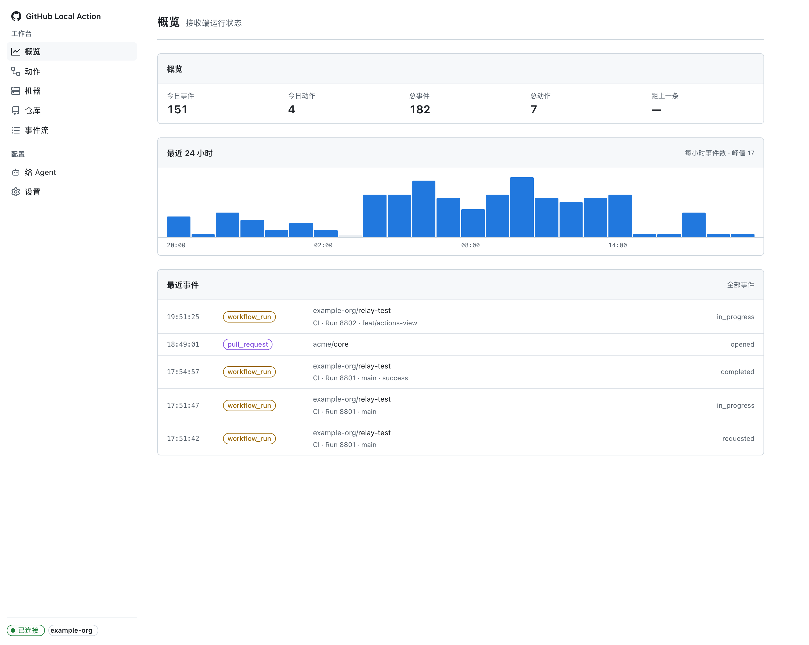
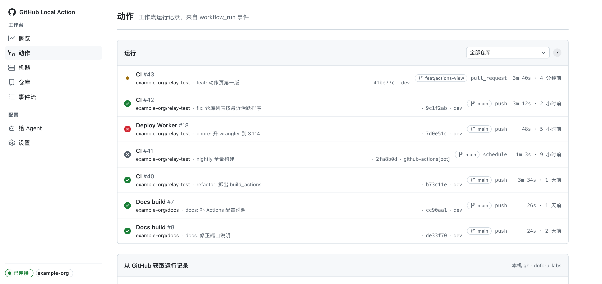

# GitHub Local Action

Stream events from every repository in your GitHub account into your own LAN, and run GitHub Actions jobs on your own machines.

```text
GitHub ──webhook──▶ remote-worker ──WebSocket──▶ local-client ──SSE──▶ LAN devices
        (public entry)   (Cloudflare)        (outbound from your box)   (localhost port)
```

[中文](README.md) · [Quickstart](docs/quickstart.md) · [Architecture](docs/architecture.md) · [Known limitations](docs/known-limitations.md)



> Documentation is Chinese-first: the guides in `docs/` are written in Chinese and the code comments are Chinese too. English issues and PRs are welcome — this page covers enough to get you running.

## What it solves

GitHub can only deliver webhooks to a public address, and its hosted runners are Microsoft's machines — neither reaches your LAN. Two independent halves bridge that gap:

| Directory | Runs on | Does |
|---|---|---|
| `remote-worker/` | Cloudflare Workers (free plan is plenty) | Receives webhooks, verifies signatures, stores in D1, pushes over WebSocket |
| `local-client/` | Your machine (macOS / Linux / Windows) | Connects out over WebSocket, persists to local SQLite, serves SSE to the LAN |

Your machine dials **out**. No public IP, no port forwarding, no tunnel. No polling — event latency is around one second.

- **Live event stream** over SSE with cursor-based resume and de-duplication
- **Actions view**: `workflow_run` events folded into runs (workflow, branch, status, trigger, duration, actor), with jobs and step states one click deeper
- **Zero-dependency status page**: one HTML file, no CDN, works offline
- **Agent-ready**: the service serves its own API manual at `/agent.md`, plus a read-only MCP server (HTTP and stdio)
- **Self-hosted runners**: install a runner on any LAN machine over SSH from the panel — Linux, macOS and Windows all verified



## Quickstart

```bash
# 1) remote (Cloudflare)
cd remote-worker && npm install
npx wrangler d1 create github_local_action     # paste database_id into wrangler.toml
npx wrangler d1 execute github_local_action --file schema.sql --remote
npx wrangler secret put GITHUB_WEBHOOK_SECRET  # same value you put in the GitHub App
npx wrangler secret put CLIENT_TOKEN           # random string for the client
npx wrangler deploy

# 2) local
cd ../local-client
python3 -m venv .venv && source .venv/bin/activate
pip install -r requirements.txt
cp config.example.toml config.toml             # fill ws_url + token
python3 relay.py
```

Then open `http://<your-lan-ip>:18091/`. Creating the GitHub App and pointing its webhook at the worker is step 2 of [docs/quickstart.md](docs/quickstart.md) (Chinese, but it is mostly a checklist — the URL and the events to subscribe to are what matter). **Subscribe to `Workflow run`**, otherwise the Actions view stays empty.

If `gh` is installed and logged in, the panel can also call the GitHub REST API to fill in jobs/steps and to fetch run history without relying on webhooks. The token stays inside `gh`'s own keyring; the relay never reads or stores it.

Installing as a command:

```bash
pip install .        # provides github-local-action and github-local-action-mcp
github-local-action -c ~/.config/github-local-action/config.toml
```

## For agents

```
Read http://127.0.0.1:18091/agent.md and operate against the endpoints it documents
```

The manual is also served at `/agent.en.md` and `/llms.txt`, so an agent only needs a URL.

```jsonc
{"mcpServers": {"github-local-action": {
  "type": "http", "url": "http://127.0.0.1:18091/mcp"}}}
```

Seven read-only tools: `health` `get_stats` `list_runs` `get_run_detail` `get_job_log` `recent_events` `list_machines`.

## Development

```bash
make test          # 18 unit tests + e2e (170+ assertions), ~1 minute
make test-fast     # unit tests only
make pii           # scan for leaked emails / private IPs / tokens / real hostnames
cd remote-worker && npm run typecheck
```

No Cloudflare account needed: `local-client/tests/mock_hub.py` is a fake hub that mirrors the real one's behaviour (token check, cursor replay, heartbeats), and the e2e suite runs entirely against it.

## License

[MIT](LICENSE). Uses [aiohttp](https://github.com/aio-libs/aiohttp) (Apache-2.0) and, optionally, [paramiko](https://www.paramiko.org/) (LGPL-2.1).
