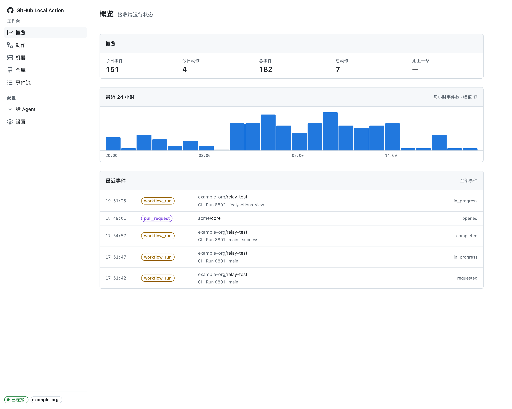
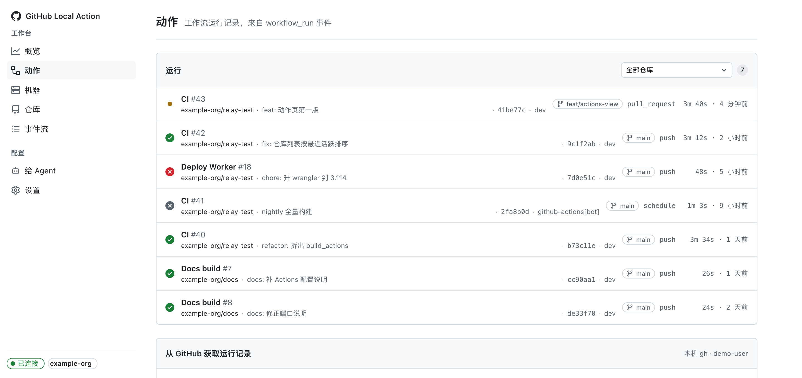
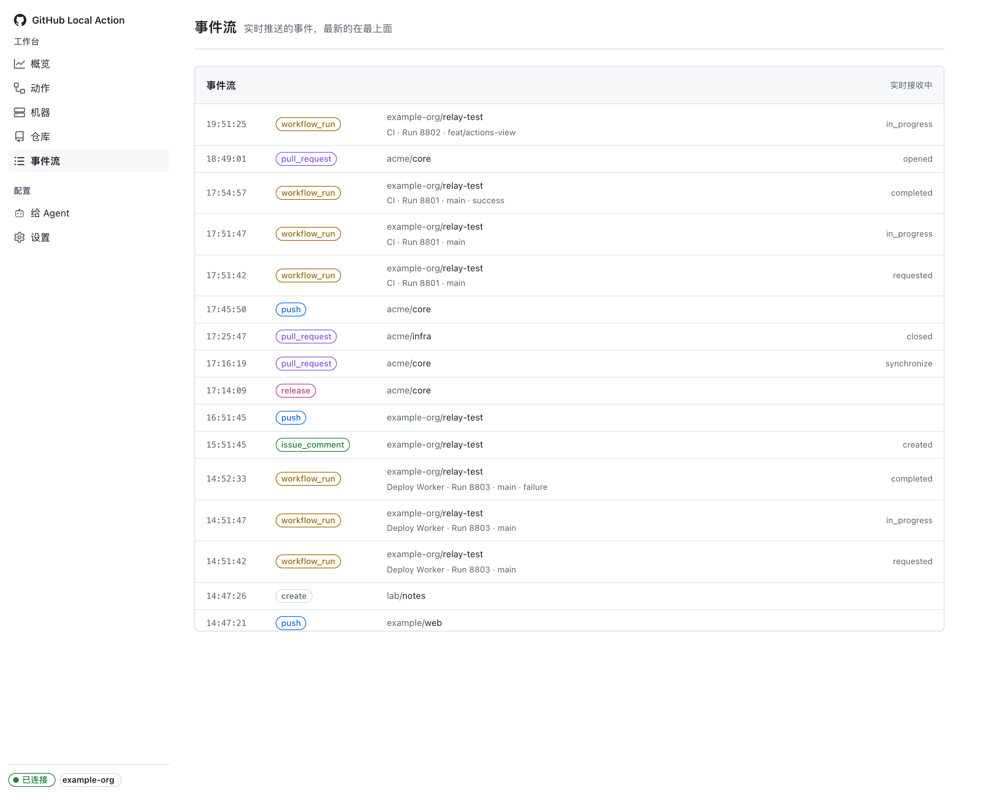

# GitHub Local Action

Stream events from every repository in your GitHub account into your own LAN, and run GitHub Actions jobs on your own machines.

```text
GitHub ──webhook──▶ remote-worker ──WebSocket──▶ local-client ──SSE──▶ LAN devices
        (public entry)   (Cloudflare)        (outbound from your box)   (localhost port)
```

[简体中文](README.zh-CN.md) · [Quickstart](docs/quickstart.md) · [Architecture](docs/architecture.md) · [Known limitations](docs/known-limitations.md)



> Code comments and commit messages are in Chinese. Documentation is bilingual: every guide in `docs/` exists in both English and Chinese.

## What it solves

GitHub only delivers webhooks to a public address, so it cannot reach your home network. And GitHub's hosted runners are Microsoft's machines — they cannot see your GPU, your serial ports, or your internal database.

Two independent halves bridge both gaps:

| Directory | Runs on | Does |
|---|---|---|
| `remote-worker/` | Cloudflare Workers (free plan is plenty) | Receives webhooks, verifies signatures, stores in D1, pushes over WebSocket |
| `local-client/` | Your machine (macOS / Linux / Windows) | Connects out over WebSocket, persists to local SQLite, serves SSE to the LAN |

Your machine dials **out** over WebSocket (NAT does not block outbound), so there is no public IP, no port forwarding, no tunnel. No polling anywhere — event latency is around one second.

## What it does

- **Live event stream**: pushes, PRs, issues, releases and `workflow_run` land in a local database; anything on the LAN gets them with `curl -N /stream`, and reconnects resume from a cursor without duplicates.
- **Actions view**: `workflow_run` events folded into runs by run id — workflow, branch, status, trigger, duration, actor — with jobs and per-step states one click deeper.
- **Built-in panel**: a single HTML file, zero external dependencies (no CDN), works fully offline.
- **Agent-ready**: the service serves its own manual at `/agent.md`, with complete endpoints, parameters, permission boundaries and copy-pasteable curl; plus a read-only MCP server over HTTP and stdio.



## Quickstart

```bash
# 1) remote (Cloudflare)
cd remote-worker && npm install
npx wrangler d1 create github_local_action     # paste database_id into wrangler.toml
npx wrangler d1 execute github_local_action --file schema.sql --remote
npx wrangler secret put GITHUB_WEBHOOK_SECRET  # same value you put in the GitHub App
npx wrangler secret put CLIENT_TOKEN           # random string for the client
npx wrangler deploy

# 2) local
cd ../local-client
python3 -m venv .venv && source .venv/bin/activate
pip install -r requirements.txt
cp config.example.toml config.toml             # fill ws_url + token
python3 relay.py
```

Then open `http://<your-lan-ip>:18091/`. Creating the GitHub App and pointing its webhook at the worker is step 2 of the [quickstart](docs/quickstart.md). **Subscribe to `Workflow run`**, otherwise the Actions view stays empty.

If `gh` is installed and logged in, the panel can also call the GitHub REST API to fill in jobs/steps and to fetch run history without relying on webhooks. The token stays inside `gh`'s own keyring; the relay never reads or stores it.

Installing as a command:

```bash
pip install .        # provides github-local-action and github-local-action-mcp
github-local-action -c ~/.config/github-local-action/config.toml
```

## For agents

Do not want to read docs and would rather have an AI drive this? Hand it one line:

```
Read http://127.0.0.1:18091/agent.md and operate against the endpoints it documents
```

The manual is also served at `/agent.en.md` and `/llms.txt`, so an agent only needs a URL — no repository checkout.

Both MCP transports work, and all seven tools are read-only:

```jsonc
// HTTP (preferred: no child process)
{"mcpServers": {"github-local-action": {
  "type": "http", "url": "http://127.0.0.1:18091/mcp"}}}

// stdio
{"mcpServers": {"github-local-action": {
  "command": "python3",
  "args": ["/absolute/path/local-client/mcp_server.py"]}}}
```

Tools: `health` `get_stats` `list_runs` `get_run_detail` `get_job_log` `recent_events` `list_machines`.

## Bring your own runner

Rather than Microsoft's machines, install a self-hosted runner on any box in your LAN and let `runs-on: [self-hosted, linux, x64]` land there. The panel's **Machines** page takes address, port, username and password, then installs, registers and starts the runner over SSH — with logs streaming live. Linux, macOS and Windows are all verified.

Details, per-platform pitfalls, and why the password only lives 30 minutes: [self-hosted runners](docs/self-hosted-runner.md).



## Docs

Every guide below is available in English and Chinese (add `.zh-CN.md` for the Chinese version).

| Doc | Contents |
|---|---|
| [Quickstart](docs/quickstart.md) | From zero to your first event, including GitHub App setup |
| [Architecture](docs/architecture.md) | Two-stage relay, protocol, dedup and resume, free-tier measurements |
| [Self-hosted runners](docs/self-hosted-runner.md) | Install, one-click SSH onboarding, platform differences |
| [Known limitations](docs/known-limitations.md) | What does not work, why, and workarounds |
| [Lab notes](docs/lab-notes.md) | Full-chain timeline of a real push, on-demand runner experiments |
| [API reference](local-client/AGENT.md) | Every HTTP / SSE / MCP endpoint (the service serves this too) |
| [Publishing checklist](docs/publishing.md) | What the maintainer checks before making the repo public |

## Development

```bash
make test          # 19 unit tests + e2e (170+ assertions), ~1 minute
make test-fast     # unit tests only
make pii           # scan for leaked emails / private IPs / tokens / real hostnames
cd remote-worker && npm run typecheck
```

No Cloudflare account needed: `local-client/tests/mock_hub.py` is a fake hub that mirrors the real one's behaviour (token check, cursor replay, heartbeats), and the e2e suite runs entirely against it. Code comments and commit messages are Chinese; PRs in Chinese or English are both fine.

## License

[MIT](LICENSE). Uses [aiohttp](https://github.com/aio-libs/aiohttp) (Apache-2.0) and, optionally, [paramiko](https://www.paramiko.org/) (LGPL-2.1).
