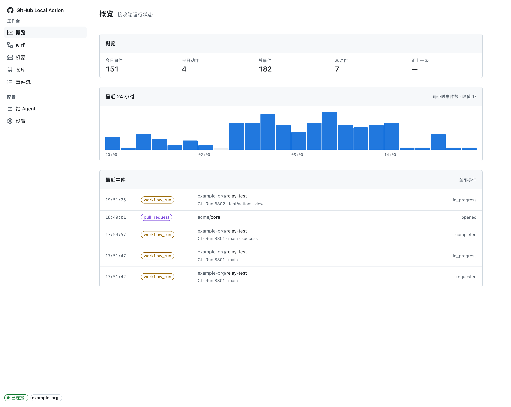
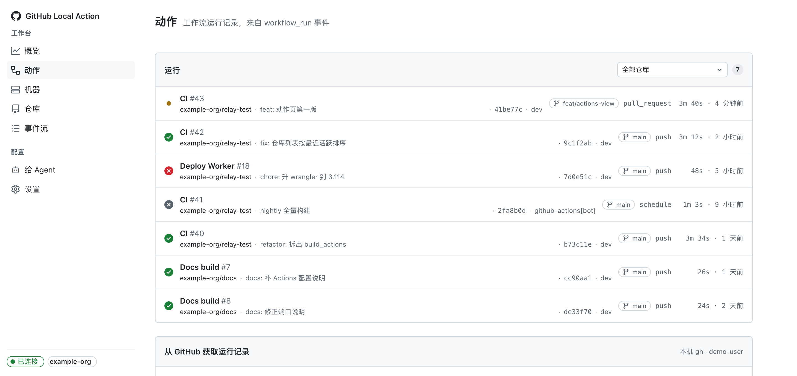
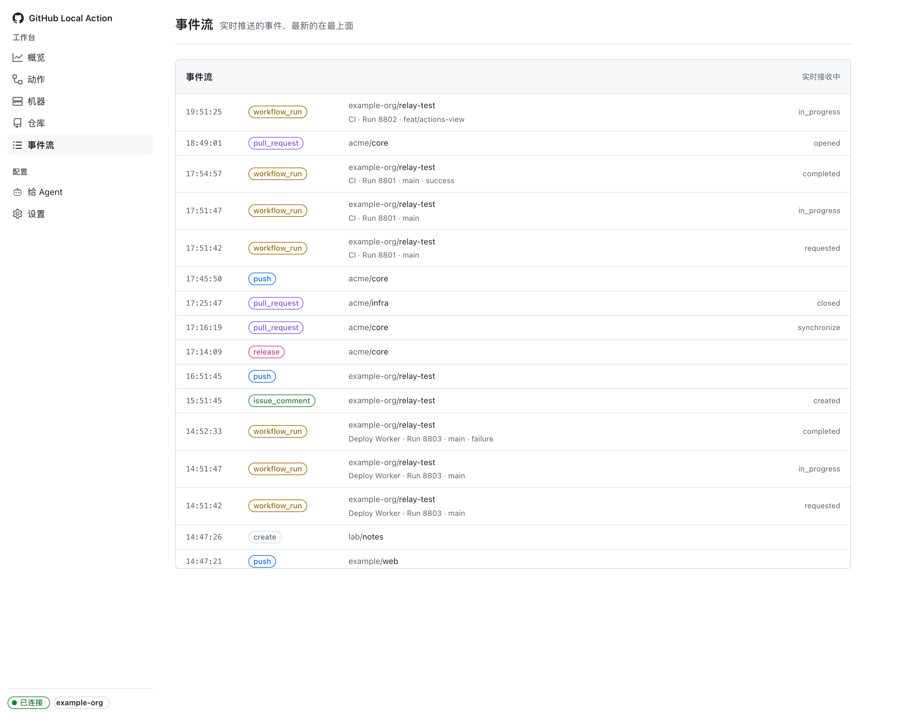

# GitHub Local Action

把 GitHub 账户下所有仓库的事件实时送进你的局域网，把 GitHub Actions 的 job 派到你自己机器上跑。

```text
GitHub ──webhook──▶ remote-worker ──WebSocket──▶ local-client ──SSE──▶ 局域网设备
         (公网入口)     (Cloudflare)      (你要连出去的线)     (本机端口)
```

[English](README.md) · [快速开始](docs/quickstart.md) · [架构](docs/architecture.md) · [已知边界](docs/known-limitations.md)



## 它解决什么问题

GitHub 只能往公网地址推 webhook，你家的网它进不去；而 GitHub 托管的 runner 是微软的机器，你机器上的显卡、串口、内网数据库它一个也碰不到。

这个项目用两个互不依赖的部件把两头接上：

| 目录 | 跑在哪 | 干什么 |
|---|---|---|
| `remote-worker/` | Cloudflare Workers（免费计划够用） | 收 webhook、验签、存 D1、通过 WebSocket 推给本地 |
| `local-client/` | 你的机器（Mac / Linux / Windows） | 连远端 WebSocket、落本地 SQLite、用 SSE 推给局域网设备 |

你的机器**主动往外连**一条 WebSocket（NAT 不拦出站），所以不需要公网 IP、不需要端口映射、不需要内网穿透。整条链路没有轮询，事件延迟 1 秒级。

## 能做什么

- **实时事件流**：push、PR、issue、release、workflow_run 全部落本地库，局域网里任何设备 `curl -N /stream` 就能拿，断线自动带游标续传、不重复。
- **动作页**：把 `workflow_run` 事件按 run id 拼成运行列表——工作流名、分支、状态、触发方式、用时、发起人，点开能看 job 和每一步的状态。
- **自带面板**：单文件 HTML，零外部依赖（不连 CDN），断网也能开。
- **一句话给 agent 用**：服务自己吐一份说明书在 `/agent.md`，带完整接口、参数、权限边界和可直接粘贴的 curl；还有只读的 MCP server（HTTP + stdio 两种传输）。



## 三分钟跑起来

```bash
# 1) 远端（Cloudflare）
cd remote-worker && npm install
npx wrangler d1 create github_local_action     # 把 database_id 填进 wrangler.toml
npx wrangler d1 execute github_local_action --file schema.sql --remote
npx wrangler secret put GITHUB_WEBHOOK_SECRET  # 和 GitHub App 里填的一致
npx wrangler secret put CLIENT_TOKEN           # 客户端连 WS 的口令，随机长串
npx wrangler deploy

# 2) 本地
cd ../local-client
python3 -m venv .venv && source .venv/bin/activate
pip install -r requirements.txt
cp config.example.toml config.toml             # 填 ws_url 和 token
python3 relay.py
```

然后浏览器打开 `http://<你的内网IP>:18091/`。中间那步「建一个 GitHub App 并把 Webhook 指过来」在 [快速开始](docs/quickstart.md) 里有逐步说明。

装了 `gh` 且已 `gh auth login` 的话，动作页还能反过来调 GitHub REST API 补齐 job 与步骤、拉任意仓库的历史运行——令牌由 gh 自己保管，接收端不读不写。

## 给 agent 用

不想看文档、想让 AI 直接操作这套东西？把这一行丢给它：

```
读 http://127.0.0.1:18091/agent.md，照里面的接口操作
```

服务把这份说明书同时挂在 `/agent.md`、`/agent.en.md`（英文）和 `/llms.txt` 上，所以 agent 只要拿到一个地址就能开工，不需要仓库。

MCP 两种传输都支持，7 个工具全只读：

```jsonc
// HTTP（推荐：不用起子进程）
{"mcpServers": {"github-local-action": {
  "type": "http", "url": "http://127.0.0.1:18091/mcp"}}}

// stdio
{"mcpServers": {"github-local-action": {
  "command": "python3",
  "args": ["/绝对路径/local-client/mcp_server.py"]}}}
```

## 也支持自己的机器当 runner

不想用 GitHub 托管的机器，可以在局域网里的任意机器上装 self-hosted runner，`runs-on: [self-hosted, linux, x64]` 直接落到它身上。面板的「机器」页能填地址、端口、用户名、密码，一键 SSH 过去把 runner 装好、注册、起服务，看日志实时往下走——Linux、macOS、Windows 三个平台都实测跑通过。

细节、各平台的坑、以及「为什么密码只活 30 分钟」在 [自建 runner](docs/self-hosted-runner.md)。



## 文档

| 文档 | 内容 |
|---|---|
| [快速开始](docs/quickstart.md) | 从零到收到第一条事件，含 GitHub App 配置 |
| [架构](docs/architecture.md) | 两级中继、协议、去重与续传、免费额度实测 |
| [自建 runner](docs/self-hosted-runner.md) | 安装、SSH 一键接入、三平台差异 |
| [已知边界](docs/known-limitations.md) | 哪些做不到、为什么做不到、绕法 |
| [实测笔记](docs/lab-notes.md) | 一次真实 push 的全链路时间线、按需 runner 实验 |
| [接口说明](local-client/AGENT.md) | HTTP / SSE / MCP 全部端点（服务自己也吐这份） |
| [发布清单](docs/publishing.md) | 维护者把仓库公开前要过的检查 |

## 开发

```bash
make test          # 19 个单测 + e2e（170+ 项断言），约 1 分钟
make test-fast     # 只跑单测
make pii           # 扫一遍仓库里有没有不该公开的邮箱 / 内网 IP / 令牌
cd remote-worker && npm run typecheck
```

测试不需要 Cloudflare 账号：`local-client/tests/mock_hub.py` 起一个行为对齐真 Hub 的假服务，e2e 全链路都在它上面跑。代码注释和 commit message 用中文，欢迎中文 PR。

## 许可证

[MIT](LICENSE)。用到了 [aiohttp](https://github.com/aio-libs/aiohttp)（Apache-2.0）和可选的 [paramiko](https://www.paramiko.org/)（LGPL-2.1）。
